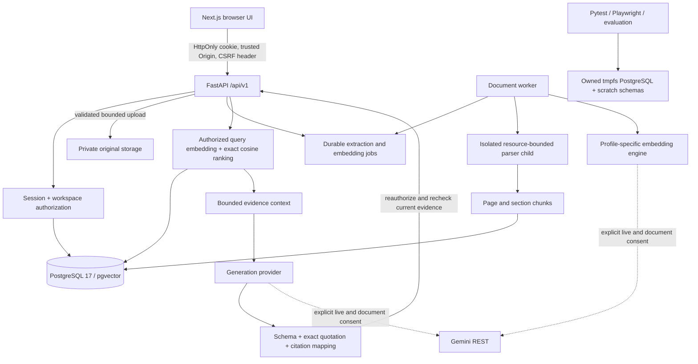

# EvidenceAI 2.0 architecture and repository audit

This is an incremental upgrade of the existing application, not a replacement.
Baseline: `ef91f507146e02b15eb81f50f2aa9043f350cbad` on local main. The index already
contained unpublished audit code and 15 JSON evidence files, and the working tree
contained the Gemini integration and publication-review derivatives. They were not
reset, committed, rewritten or discarded. Cached `origin/main` remains
`a12b93d5a6802572a21089abb99de154d9056313`, one commit behind local main;
this was a local tracking-ref inspection, not a fresh GitHub fetch. Restricted baseline hashes and the staged
patch were captured outside Git before this work. Production remains **FAIL / BLOCKED**.

## Dependency map

| Layer | Existing implementation | 2.0 increment |
|---|---|---|
| Identity | auth routes, browser_security, hashed browser-bound registration, session touch/expiry | Preserved; no bypass or new credential exposure |
| Tenancy | authorization.py, workspace_transaction.py, ownership consistency | Reused for readiness, previews, comparison and indexing |
| Originals | document_service/storage, checksums, cleanup reservations | Remain private; no original uploaded to an AI provider |
| Parsing | document_parser_child, pypdf, strict UTF-8, isolated subprocess/resource limits | Optional layout-preserving text PDF extraction; Markdown Setext headings |
| Processing | document_jobs, leases, generation fencing, bounded attempts | No queue/schema rewrite; existing recovery preserved |
| Vectors | embedding_profiles, chunk_embeddings, embedding_jobs | Existing Gemini adapter; document/query tasks; explicit active-profile readiness |
| Retrieval | search_service, dimension-safe CASE, deterministic order | Bounded offset pagination; same workspace/profile restrictions |
| Research | rag_service/context, GroundedOutput, citation_validation | Extractive topic briefs and two-source comparisons, coverage checks |
| History | conversation_service, immutable citation snapshots, per-user conversations | Default question fingerprints remain backward compatible |
| Frontend | Next app router, existing library/search/research/conversations | Provider readiness, extracted previews, progress, comparison, local text export |
| Operations | telemetry, health/readiness, metrics, release/security scripts | Gemini enum labels only; release policy unchanged |
| Verification | owned disposable runner, no-live-HTTP tests, Vitest fetch guard | Consent/readiness/provenance regressions and three-engine browser case |

Python remains FastAPI + synchronous SQLAlchemy/Psycopg with httpx adapters. Worker
and API must agree on embedding provider/model/revision/dimensions. Gemini uses the
existing REST transport dependency; no SDK or infrastructure purchase was added.
Frontend client components use existing authenticated API helpers; secrets stay
backend-only. Installed Next.js guides were consulted before frontend changes.

## Feature audit

| Capability | Status and boundary |
|---|---|
| Secure signup, private workspaces, RBAC, ownership transfer | Implemented, existing regressions retained |
| PDF/TXT/Markdown uploads, checksum duplicates, download/deletion | Implemented; tests use disposable records/files only |
| Page/section/source spans, chunk previews, processing recovery | Implemented; previews are bounded and authorized |
| Text-PDF table layout | Optional layout extraction; no structured-cell/semantic table guarantee |
| Active-profile indexing/readiness, query filters/pagination | Implemented; Ready is local configuration/state, not a live provider probe |
| Gemini generation/embedding REST contracts | Offline-tested; live access/free eligibility NOT VERIFIED |
| Question answering, topic briefs, multi-source quotes/comparison | Implemented as exact extracts; general semantic synthesis remains unverified |
| Saved follow-up conversations/cited notes | Existing saved conversations and citation snapshots; not a new rich note editor |
| English/Nepali | Exact-source examples validated offline; Gemini multilingual retrieval/translation NOT VERIFIED |
| Local cited report export | User-initiated text download; no connector or server sharing |
| OCR, multimodal PDF, reranking/hybrid search | Not enabled; separate measured/security-reviewed increments |
| Source credibility | Explicitly unassessed; provenance is not a truth score |
| Production readiness | FAIL / BLOCKED; container security and hosted acceptance are not closed |

## Data and migration safety

No Alembic revision is needed. Existing untyped pgvector columns allow 8–3072
components and enforce per-profile dimensions. Gemini 768 vectors get a distinct
provider/model/revision/dimension hash; previous vectors, chunk IDs and files remain.
No existing document is automatically reprocessed or reindexed by this change.
The optional PDF extraction mode affects only future authorized extraction jobs.

New HTTP fields are additive and default to old question/search behavior. Default
conversation request fingerprints omit the new default `mode` field, preserving
old idempotency keys; non-default research modes are included in fingerprints.
Preview text is plain rendered content, never HTML. Export is plain text generated
locally on an explicit click. No new privileged service, agent or connector exists.
