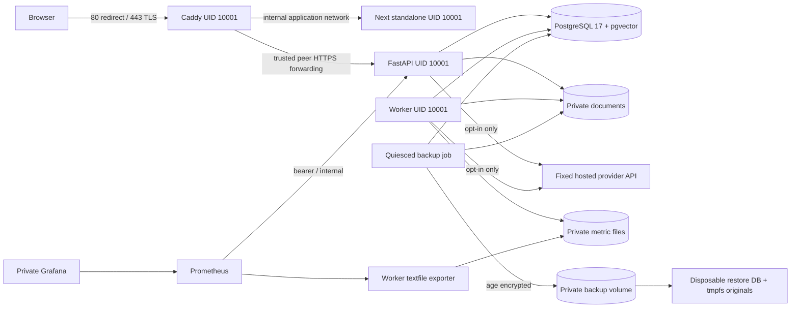

# Production architecture

Milestone 11 prepares a single Linux host running Docker Compose. This is a deployment
candidate, **not production acceptance**. Milestone 12 must accept the release, operational
controls and remaining security findings before public rollout. No public host or DNS was
changed during implementation.

## Boundaries

Production uses `infra/compose.production.yml`. Staging layers `compose.staging.yml` on
top: loopback ports 18080/18443 and a private Caddy CA. Existing local development remains
`infra/docker-compose.yml` on PostgreSQL host port 5433; its project, image, volume and
records are not reused by deployment scripts.

Only Caddy publishes host ports (80/443 in production). Web, API, DB, workers, exporters,
Prometheus and Grafana have no published ports. The application, database, monitoring and
recovery bridges are internal. Caddy alone joins ingress; API/worker have a separate
outbound bridge for explicitly enabled hosted providers. The frontend has no outbound
network requirement. Outbound bridges are not domain allowlists; host firewall/egress
policy is a Milestone 12 deployment control. No container mounts the Docker socket.

The database bridge connects DB/API/worker and explicit migration/backup operations.
The monitoring bridge connects the API, worker/exporter, Prometheus and Grafana. The
recovery bridge connects only the disposable restore database and verifier. Docker/host
administrators remain trusted: Docker daemon access is effectively host administration.
Internal bridges do not isolate a compromised API from its own database or storage.

Caddy uses a fixed application-network address: 172.30.11.10 in production, 172.30.21.10
in staging. The API trusts forwarded headers only from that one address, with client
forwarded headers replaced at the proxy. The fixture uses a separate 172.30.31.0/24
network. Reserve these ranges or consistently change IPAM and TRUSTED_PROXY_IP; running
two copies of the same environment with overlapping subnets requires operator adjustment.

## Images and process model

- API and worker share the Python 3.14.6 Debian image. All pinned requirements must have
  binary wheels; a missing wheel fails the build. Test-only packages are removed from
  runtime. API runs one Uvicorn process so Prometheus counters remain process-local.
- The Node 26.12.0 runtime serves Next.js standalone output, including public/static
  assets. Webpack is the standard production build (`npm run build`), avoiding the
  previously observed Turbopack loader socket failure. No hot reload or runtime npm is
  included. Build/runtime API configuration is `same-origin`; no secret enters the bundle.
- The proxy derives from an immutable Caddy image. Its privileged-port file capability
  is removed, allowing UID 10001 and `cap_drop: ALL` on ports 8080/8443 internally.
- Backup tooling uses the same Python base, age encryption and PostgreSQL 17 clients
  copied from the pinned pgvector image. It does not inherit a DB server entrypoint or
  implicit database volume. All plaintext backup work is in bounded tmpfs.
- PostgreSQL runs as UID 999. Application connections use the `evidenceai` role, which
  cannot create roles/databases and is not a superuser. Initial DB/bootstrap uses a
  separately protected admin credential. The app role owns its schema/migrations;
  runtime-vs-migration role separation remains a future privilege reduction.

Base references are immutable digests. App dependencies are pinned in requirements and
package-lock. Debian security updates are applied during release builds; apt repository
contents are not snapshotted, so rebuilding a source commit is not guaranteed bit-for-bit
identical. Promote the exact tested image digests and keep the release manifest/scans;
do not rebuild an accepted release in place. CI tags candidates with the full Git SHA.

Read-only root filesystems, no-new-privileges, dropped capabilities, PID/memory/CPU limits,
log rotation, health checks and explicit stop grace periods apply. Writable paths are
private persistent volumes or bounded tmpfs. Defaults cap DB connections at 80, app role
connections at 40, and each API/worker pool at 5 plus 3 overflow. These are initial limits,
not measured capacity guarantees. RAG advisory locks also consume pool capacity.

## Persistence and future services

Project-scoped volumes hold DB data, private originals, worker metrics, proxy certificate
state, encrypted backups, Prometheus data and Grafana state. Document root is
`/data/documents`, UID 10001, mode 0700; originals remain mode 0600. The image initializes
empty volume ownership without a recurring privileged init container. API and worker share
only the document volume; the web and proxy never mount it.

SQLAlchemy configuration remains the managed-PostgreSQL boundary; future managed deployment
must supply a private endpoint, restricted role, verified TLS and provider-specific backup
controls. `DocumentStorage` remains the storage boundary for a future private S3 adapter;
no S3 service/public bucket or paid cloud resource is introduced. Migrations, leases,
identity and workspace authorization remain in the existing PostgreSQL implementation.
